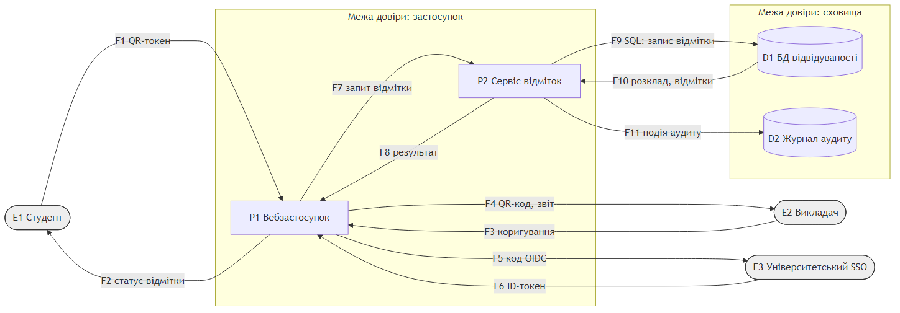

# Модель загроз: система обліку відвідуваності занять

**Варіант:** 5  ·  **Пріоритетна категорія STRIDE:** відмова від авторства (Repudiation)  ·  **Здобувач:** Горох Богдан Дмитрович  ·  **Група:** ІП-32

## 1. Опис системи та активи

Система (умовна назва «Відмітка») фіксує присутність студентів на заняттях. На початку заняття
викладач відкриває його у вебкабінеті, і система показує на проєкторі динамічний QR-код, що
змінюється кожні 15 секунд. Студент сканує код мобільним застосунком, і сервіс відміток записує
факт присутності. Викладач може вручну виправити відмітку (запізнення, поважна причина) і
вивантажити звіт про пропуски, на основі якого вирішується допуск до сесії.

Користувачі: студент (E1) і викладач (E2). Зовнішня служба: університетський SSO (E3, протокол
OpenID Connect), через який автентифікуються всі користувачі; власних паролів система не зберігає.
Вебзастосунок (P1) приймає запити, виконує вхід через SSO і формує звіти; сервіс відміток (P2)
перевіряє QR-токени, записує й виправляє відмітки та пише кожну зміну в журнал аудиту.
Усі дані в моделі синтетичні.

| № | Актив | Тип | Цінність (К/Ц/Д) |
|---|-------|-----|------------------|
| A1 | Записи відвідуваності (хто, яке заняття, час, спосіб відмітки) | дані | С/В/С |
| A2 | Персональні дані студентів (ПІБ, група, корпоративна пошта) | дані | В/С/Н |
| A3 | Сесійні токени (JWT) та ключ їх підпису | облікові дані | В/В/С |
| A4 | Секретний ключ генерації QR-токенів (HMAC) | ключ | В/В/С |
| A5 | Журнал аудиту (хто, що й коли створив або змінив) | журнал подій | С/В/С |
| A6 | Розклад занять і списки груп | дані | Н/В/В |
| A7 | Безперервність послуги під час заняття | послуга | -/-/В |

Шкала: В - висока, С - середня, Н - низька. Цілісність A1 і A5 висока, бо звіт про пропуски
впливає на допуск до сесії, а журнал аудиту - єдиний доказ того, хто змінив запис.

## 2. Діаграма потоків даних

Джерело діаграми: [dfd.mmd](dfd.mmd), зображення: [dfd.png](dfd.png).



Елементи діаграми:

| Тип | Елементи |
|-----|----------|
| Зовнішні сутності | E1 Студент, E2 Викладач, E3 Університетський SSO |
| Процеси | P1 Вебзастосунок, P2 Сервіс відміток |
| Сховища | D1 БД відвідуваності, D2 Журнал аудиту (лише дописування) |
| Потоки | F1-F11 (підписані на діаграмі, кожен потік однонапрямний) |

Межі довіри:

- TB1 "застосунок" - процеси P1 і P2. Межу перетинають потоки F1-F4 від користувачів з
  Інтернету (найменш довірена зона) та F5, F6 від зовнішнього SSO, яким система не керує.
- TB2 "сховища" - D1 і D2. Межу перетинають потоки F9-F11 між сервісом відміток і сховищами.

Потоки F7 і F8 проходять усередині TB1 і межі не перетинають.

## 3. Загрози за STRIDE

Застосовано STRIDE за елементами (таблиця 2.2 методичних вказівок): для зовнішніх сутностей - S і R,
для процесів - усі шість категорій, для сховищ - T, I, D, а R лише для журналу D2, для потоків - T, I, D.

| № | Елемент/потік | Категорія STRIDE | Опис загрози | Порушувана властивість |
|---|---------------|------------------|--------------|------------------------|
| T-01 | E1 Студент | S | Присутній студент фотографує QR-код і пересилає його в месенджер; відсутній одногрупник відмічається дистанційно протягом 15 секунд дії коду | автентичність |
| T-02 | E1 Студент | R | Студент передає телефон з відкритою сесією іншій особі, а потім заперечує відмітку; система не фіксує пристрій і не може довести, хто її зробив | неспростовність |
| T-03 | E1 Студент | R | Студент стверджує, що застосунок показав статус "відмічено" (F2), хоча в D1 запису немає; відповідь не підписана й не зберігається, тому спір не розв'язується | неспростовність |
| T-04 | E2 Викладач | R | Викладач за домовленістю ставить студенту присутність через коригування, а під час перевірки заперечує це; коригування не вимагає причини й повторної автентифікації | неспростовність |
| T-05 | P1 Вебзастосунок | S | Збережений XSS у полі коментаря до заняття викрадає сесійний JWT викладача з localStorage; зловмисник діє від імені викладача | автентичність |
| T-06 | P1 Вебзастосунок | R | Вивантаження звіту з персональними даними не журналюється; у разі витоку неможливо встановити, хто й коли отримав файл | неспростовність |
| T-07 | P1 Вебзастосунок | I | Маршрут /reports/{group_id} не перевіряє, чи веде викладач цю групу (IDOR); будь-який автентифікований користувач отримує ПІБ і пошту студентів чужих груп | конфіденційність |
| T-08 | P1 Вебзастосунок | D | Скрипт надсилає тисячі запитів на маршрут відмітки на початку заняття; за 15-секундне вікно QR-коду студенти не встигають відмітитися | доступність |
| T-09 | P1 Вебзастосунок | E | Роль перевіряється лише в інтерфейсі; студент напряму викликає API коригування й ставить собі присутність, бачачи при цьому список групи | авторизація |
| T-10 | P2 Сервіс відміток | R | Подія аудиту (F11) містить лише "запис змінено" без автора, старого й нового значення та часу сервера; зміну неможливо приписати конкретній особі | неспростовність |
| T-11 | P2 Сервіс відміток | I | Секретний ключ HMAC для генерації QR-токенів потрапляє в публічний репозиторій або в текст помилки; зловмисник генерує валідні токени для будь-якого заняття | конфіденційність |
| T-12 | P2 Сервіс відміток | E | Код заняття з F7 підставляється в SQL-запит конкатенацією; SQL-ін'єкція дає довільні запити до D1 з правами сервісу | авторизація |
| T-13 | D1 БД відвідуваності | T | Обліковий запис сервісу має права UPDATE на всі таблиці, а його пароль лежить у конфігурації; зловмисник у внутрішній мережі змінює відмітки напряму, оминаючи журнал | цілісність |
| T-14 | D2 Журнал аудиту | R | Адміністратор БД редагує або видаляє записи журналу, бо журнал - звичайна таблиця без захисту від зміни; журнал перестає бути доказом | неспростовність |
| T-15 | F1 QR-токен | T | Мобільний застосунок передає час сканування, і студент через проксі підміняє його в запиті, щоб уникнути позначки "запізнення" | цілісність |
| T-16 | F5, F6 (до SSO) | D | Університетський SSO недоступний на початку заняття; вхід неможливий, і ніхто не може відмітитися | доступність |

Розподіл за категоріями: R - 6, S - 2, T - 2, I - 2, D - 2, E - 2. Пріоритетна категорія варіанта (R)
переважає.

## 4. Оцінювання ризиків (CVSS / матриця)

Вектори обчислено калькулятором cvss.py через допоміжний файл lab01_threat_model/scoring.py.
Контрольний вектор CVSS:3.1/AV:N/AC:L/PR:N/UI:N/S:U/C:H/I:H/A:H дає 9.8.

Вплив визначено за базовою оцінкою: Н - менше 4,0, С - від 4,0 до 6,9, В - від 7,0. Імовірність
оцінено експертно для системи без контрзаходів. Ранг ризику - за матрицею:

| Імовірність \ Вплив | Н | С | В |
|----------------------|---|---|---|
| В | середній | високий | високий |
| С | низький | середній | високий |
| Н | низький | низький | середній |

| № загрози | Вектор CVSS | Базова оцінка | Імовірність | Вплив | Ранг ризику |
|-----------|-------------|---------------|-------------|-------|-------------|
| T-01 | AV:N/AC:L/PR:L/UI:N/S:U/C:N/I:L/A:N | 4.3 | В | С | високий |
| T-02 | AV:N/AC:L/PR:L/UI:N/S:U/C:N/I:L/A:N | 4.3 | С | С | середній |
| T-03 | AV:N/AC:H/PR:L/UI:N/S:U/C:N/I:L/A:N | 3.1 | С | Н | низький |
| T-04 | AV:N/AC:L/PR:L/UI:N/S:U/C:N/I:H/A:N | 6.5 | С | С | середній |
| **T-05** | AV:N/AC:L/PR:N/UI:R/S:U/C:H/I:H/A:N | **8.1** | С | В | високий |
| T-06 | AV:N/AC:L/PR:L/UI:N/S:U/C:L/I:N/A:N | 4.3 | С | С | середній |
| T-07 | AV:N/AC:L/PR:L/UI:N/S:U/C:H/I:N/A:N | 6.5 | С | С | середній |
| **T-08** | AV:N/AC:L/PR:N/UI:N/S:U/C:N/I:N/A:H | **7.5** | С | В | високий |
| **T-09** | AV:N/AC:L/PR:L/UI:N/S:U/C:L/I:H/A:N | **7.1** | С | В | високий |
| T-10 | AV:N/AC:L/PR:L/UI:N/S:U/C:N/I:H/A:N | 6.5 | В | С | високий |
| **T-11** | AV:N/AC:L/PR:N/UI:N/S:U/C:H/I:H/A:N | **9.1** | С | В | високий |
| **T-12** | AV:N/AC:L/PR:L/UI:N/S:U/C:H/I:H/A:H | **8.8** | Н | В | середній |
| T-13 | AV:A/AC:H/PR:L/UI:N/S:U/C:H/I:H/A:N | 6.4 | Н | С | низький |
| T-14 | AV:N/AC:L/PR:H/UI:N/S:U/C:N/I:H/A:N | 4.9 | С | С | середній |
| T-15 | AV:N/AC:L/PR:L/UI:N/S:U/C:N/I:L/A:N | 4.3 | В | С | високий |
| T-16 | AV:N/AC:H/PR:N/UI:N/S:U/C:N/I:N/A:H | 5.9 | Н | С | низький |

Префікс CVSS:3.1/ у таблиці опущено. Загрози високого ризику (базова оцінка не нижче 7,0) виділено:
T-05, T-08, T-09, T-11, T-12 - п'ять загроз при мінімумі три. Найкритичніша - T-11 (9.1, критичний рівень).

## 5. Реєстр ризиків і рішення

Вихідний ризик - ранг із розділу 4 (у дужках - базова оцінка CVSS). Залишковий ризик - ранг після
впровадження контрзаходу.

| № | Ризик | Рішення (усунути/зменшити/передати/прийняти) | Контрзахід | Залишковий ризик |
|---|-------|----------------------------------------------|------------|------------------|
| T-01 | Пересилання QR відсутньому - високий (4.3) | зменшити | Відмітка приймається лише з Wi-Fi мережі аудиторії (перевірка BSSID); викладач бачить кількість відмічених і порівнює її з присутніми | середній |
| T-02 | Заперечення відмітки з переданого телефона - середній (4.3) | прийняти | Обґрунтування: прив'язка до пристрою не допомагає, коли передано сам телефон, а біометрія коштує більше, ніж шкода від однієї спірної відмітки; спір розв'язує викладач | середній |
| T-03 | Спір щодо статусу F2 - низький (3.1) | прийняти | Обґрунтування: підписані квитанції для кожної відмітки дорожчі за шкоду; спір розв'язується за журналом D2 | низький |
| T-04 | Викладач заперечує коригування - середній (6.5) | зменшити | Коригування лише з обов'язковою причиною і повторним входом через SSO; запис у D2 з автором | низький |
| T-05 | Викрадення JWT через XSS - високий (8.1) | усунути | Екранування виводу, заголовок Content-Security-Policy; JWT у cookie з прапорцями HttpOnly, Secure, SameSite=Strict | низький |
| T-06 | Вивантаження звіту не журналюється - середній (4.3) | усунути | Кожне вивантаження пишеться в D2: хто, яка група, час | низький |
| T-07 | IDOR у звітах - середній (6.5) | усунути | Серверна перевірка, що група належить викладачеві, для кожного запиту | низький |
| T-08 | Флуд на початку заняття - високий (7.5) | зменшити | Обмеження частоти запитів на P1 за користувачем та IP; токен перевіряється за часом прийому на шлюзі, тож черга не "з'їдає" вікно дії коду | середній |
| T-09 | Студент викликає API коригування - високий (7.1) | усунути | Перевірка ролі на сервері для кожного маршруту, заборона за замовчуванням | низький |
| T-10 | Журнал без автора й значень - високий (6.5) | усунути | Структурований запис аудиту: автор із JWT, старе й нове значення, причина, серверний час | низький |
| T-11 | Витік ключа HMAC для QR - високий (9.1) | усунути | Окремий випадковий 256-бітний ключ на кожне заняття, створюється в пам'яті P2 під час відкриття заняття й знищується після закриття; gitleaks у CI; вимкнений режим налагодження | низький |
| T-12 | SQL-ін'єкція через код заняття - середній (8.8) | усунути | Параметризовані запити (ORM), перевірка формату коду заняття | низький |
| T-13 | Зміна БД в обхід журналу - низький (6.4) | зменшити | Обліковий запис сервісу без права UPDATE для старих записів, пароль у сховищі секретів, щонічна звірка D1 з D2 | низький |
| T-14 | Редагування журналу аудиту - середній (4.9) | зменшити | Журнал лише на дописування (окремий обліковий запис без UPDATE і DELETE), ланцюжок хешів записів, щоденна копія останнього хешу поза системою | низький |
| T-15 | Підміна часу сканування - високий (4.3) | усунути | Час відмітки визначає сервер, поле часу від клієнта ігнорується | низький |
| T-16 | Недоступність SSO - низький (5.9) | передати | Угода про рівень обслуговування з університетським ІТ-підрозділом, що супроводжує SSO; резерв - викладач вносить відмітки пізніше з причиною | низький |

Контрзаходи, що перекривають кілька загроз одночасно:

- захищений журнал аудиту (структуровані записи, лише дописування, ланцюжок хешів) - T-04, T-06,
  T-10, T-14, а також виявлення T-13 через звірку D1 з D2;
- серверна авторизація з забороною за замовчуванням - T-07, T-09;
- ключ QR на кожне заняття - усі гілки дерева атак для T-11 (розділ 6).

## 6. Дерево атак для найкритичнішої загрози

Найкритичніша загроза - T-11 (9.1). Корінь дерева - мета цієї загрози.

```
Мета (T-11): генерувати валідні QR-токени для будь-якого заняття без присутності
  AND
  ├── 1. Отримати секретний ключ HMAC
  │     OR
  │     ├── 1.1 Знайти ключ у репозиторії
  │     │     OR
  │     │     ├── 1.1.1 Прочитати закомічений файл .env у публічному репозиторії
  │     │     └── 1.1.2 Відновити "видалений" ключ з історії комітів (git log -p)
  │     ├── 1.2 Отримати ключ із повідомлення про помилку
  │     │     AND
  │     │     ├── 1.2.1 Надіслати на F1 пошкоджений QR-токен, (виняток)
  │     │     └── 1.2.2 Прочитати змінні оточення на сторінці налагодження
  │     └── 1.3 Підібрати слабкий ключ
  │           AND
  │           ├── 1.3.1 Сфотографувати кілька QR-кодів одного заняття
  │           └── 1.3.2 Перебрати словник ключів офлайн
  └── 2. Дізнатися формат токена
        OR
        ├── 2.1 Декодувати сфотографований QR-код (рядок "заняття|час|HMAC")
        └── 2.2 Декомпілювати мобільний застосунок
```

Найдешевший шлях для порушника: 1.1.1 + 2.1 - дві дії без спеціальних навичок.

Перекриття гілок контрзаходами (з розділу 5):

| Гілка | Контрзахід | Результат |
|-------|------------|-----------|
| 1.1.1, 1.1.2 | ключ на кожне заняття створюється в пам'яті P2 і ніде не зберігається; gitleaks у CI | ключа в репозиторії немає, 1.1 закрита |
| 1.2.2 | вимкнений режим налагодження, загальні повідомлення про помилки | 1.2 - вузол AND, тож закриття одного листа закриває гілку |
| 1.3.2 | випадковий 256-бітний ключ замість словникового | перебір неможливий, 1.3 закрита |
| 2.1, 2.2 | не перекривається: формат токена неминуче відкритий | захист не може спиратися на секретність формату (принцип Керкгоффса) |

Корінь - вузол AND, тож захисникові достатньо перекрити одну дочірню гілку. Гілку 2 закрити неможливо,
тому перекрито всі три варіанти гілки 1 (це вузол OR, і порушникові вистачить будь-якого). Ключ на
кожне заняття закриває 1.1 і 1.3 одним заходом, а для 1.2 обмежує шкоду одним заняттям.

## 7. Висновки

### Аналіз результатів

1. Розподіл за STRIDE: R - 6 загроз із 16 (37,5 %), S, T, I, D, E - по 2. Гіпотеза підтвердилася за
   кількістю: головна цінність системи - доказ того, хто був присутній і хто змінив відмітку, тому
   спорів "це не я" найбільше. За тяжкістю R не домінує: найвища оцінка R - 6.5, жодна загроза R
   не має оцінки 7,0 і вище. Усі п'ять загроз високого ризику належать до S, D, I та E (T-05, T-08,
   T-09, T-11, T-12), бо CVSS оцінює пряму шкоду конфіденційності, цілісності й доступності, а
   втрата неспростовності виражається лише через вплив на цілісність (I:L або I:H).
2. Найвразливіші елементи - процеси P1 (5 загроз) і P2 (3 загрози): до процесів застосовні всі
   шість категорій. P1 стоїть на межі TB1 і приймає всі потоки з Інтернету (F1, F3) та від SSO (F6).
   Загалом 11 із 16 загроз (T-01 - T-09, T-15, T-16) стосуються елементів на зовнішній межі TB1, де
   дані з найменш довіреної зони входять у застосунок.
3. T-11 отримала найвищу оцінку 9.1, бо поєднує найлегшу експлуатованість (AV:N, AC:L, PR:N, UI:N
   дають 3.89, максимум для S:U) і високий вплив C:H та I:H (ISS = 0.806, Impact = 5.18). T-12 має ще
   й A:H, але PR:L знижує експлуатованість до 2.84, і оцінка - 8.8. Вирішальна метрика - PR:N: ключ
   із публічного репозиторію не потребує жодного облікового запису.
4. Найбільше гілок дерева атак перекриває ключ QR на кожне заняття (гілки 1.1 і 1.3, обмежує 1.2).
   У реєстрі найбільше загроз перекриває захищений журнал аудиту: чотири загрози R (T-04, T-06,
   T-10, T-14) і виявлення T-13. Він ефективніший за точкові заходи, бо усуває спільну причину -
   журнал, якому не можна довіряти, а не окремий симптом.
5. Стратегію "прийняти" обрано для T-02 і T-03. Для T-02 прив'язка до пристрою не допомагає, коли
   передано сам телефон, а біометрична перевірка коштує більше за шкоду від однієї спірної відмітки.
   Для T-03 (3.1, низький) підписані квитанції для кожної відмітки дорожчі за спір, який викладач
   розв'язує за журналом D2.

### Висновки

1. Для системи обліку відвідуваності побудовано модель загроз: 7 активів, DFD з 2 межами довіри та
   11 потоками, 16 загроз за STRIDE, з них 5 високого ризику (від 7.1 до 9.1).
2. Пріоритетна категорія R домінує за кількістю (6 із 16), але не за тяжкістю: максимальна оцінка R
   6.5 проти 9.1 у найкритичнішої загрози T-11 (витік ключа HMAC, категорія I).
3. Найкритичніша загроза T-11 найдешевше реалізується двома діями без спеціальних навичок:
   прочитати ключ у публічному репозиторії й декодувати сфотографований QR-код.
4. Найбільший ефект за найменших витрат дають три контрзаходи: ключ QR на кожне заняття (закриває
   дерево атак T-11), захищений журнал аудиту (4 загрози R і виявлення T-13) та серверна авторизація
   (T-07, T-09). Після впровадження реєстру жодна загроза не має високого залишкового ризику.
